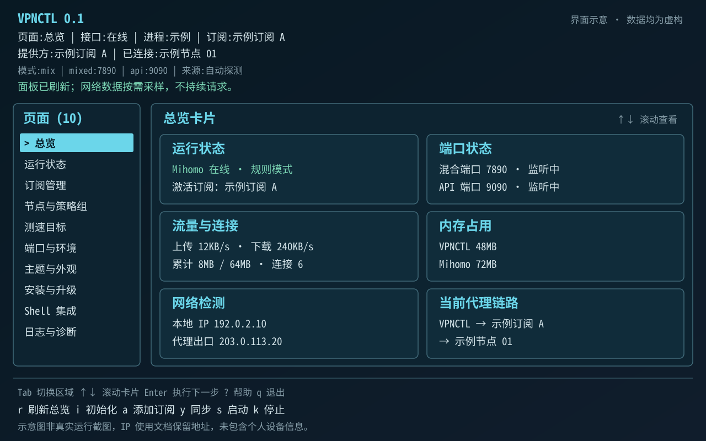
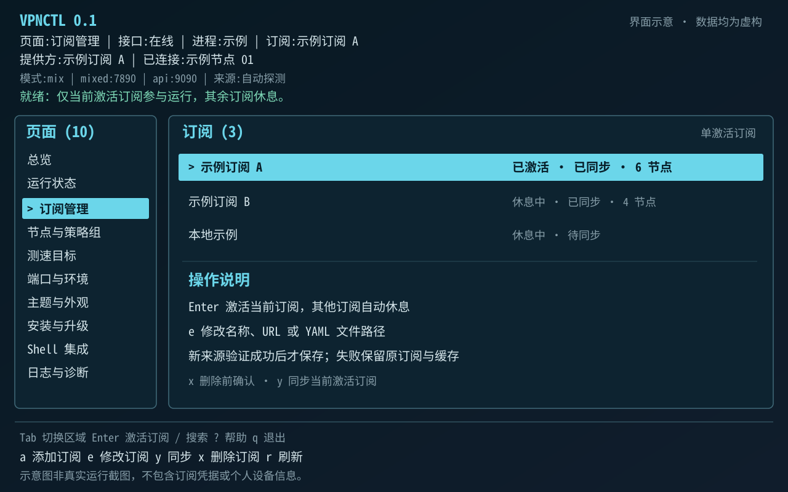
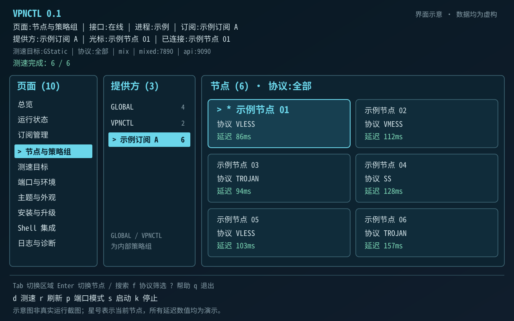

# VPNCTL

[](https://github.com/Eaick/Vpnctl)
[](https://nodejs.org/)
[](https://github.com/MetaCubeX/mihomo)
[](https://opensource.org/licenses/MIT)
[](https://github.com/Eaick/Vpnctl)

```text
██╗   ██╗██████╗ ███╗   ██╗ ██████╗████████╗██╗
██║   ██║██╔══██╗████╗  ██║██╔════╝╚══██╔══╝██║
██║   ██║██████╔╝██╔██╗ ██║██║        ██║   ██║
╚██╗ ██╔╝██╔═══╝ ██║╚██╗██║██║        ██║   ██║
 ╚████╔╝ ██║     ██║ ╚████║╚██████╗   ██║   ███████╗
  ╚═══╝  ╚═╝     ╚═╝  ╚═══╝ ╚═════╝   ╚═╝   ╚══════╝
```

## 最新动态

**2026-10-16 · CLI 管理维护更新（VPNCTL 0.1.1）**

- 新增 Codex / Claude Code 双标签 CLI 管理，诊断报告与选项使用分割线分区。
- Codex Daemon 修复确认后实际执行：按需停止、对齐 CLI 版本、携带 VPNCTL 当前 HTTP 代理环境启动并复查；版本一致但代理环境不同也可修复，不会自动中断任务。
- 支持 Codex 账号与额度的手动只读查询；无法验证的数据明确标注，不将网络连通等同于登录成功。
- Claude 新增原生 Anthropic API 账号的增删改查、切换和模型映射，保留动态终端代理及安全配置恢复。
- OpenAI Chat / Responses 配置目前只能保存，转换服务尚未接通，不能激活；未提供 1M 上下文声明开关。

**2026-10-09 · VPNCTL 0.1.1**

- 节点页按终端宽度显示 1～4 列卡片，低高度时自动使用紧凑列表。
- 将可识别的流量、到期、重置和公告提示放入只读提示区，按 `v` 展开或收起，不参与节点选择和测速。
- 保留独立光标和当前使用标记，修正三角标记的终端宽度问题，支持方向键按卡片移动。
- 新增 `vpnctl --version`，TUI 顶部同步显示 VPNCTL 程序版本。
- 保留原有订阅下载、节点名称、Mihomo 配置和 provider 测速回退逻辑，并补充终端渲染及切换、测速回归测试。

> 流量提示来自最近同步的订阅节点文字，不是实时余额。本版尚未解析 `subscription-userinfo` 响应头；若机场只通过响应头提供流量信息，则不会显示额度。

**2026-10-07 · VPNCTL 0.1 维护更新**

- 修复部分机场根据客户端类型返回不同节点配置，导致 VPNCTL 测速显示 `ERR` 的兼容问题。
- 订阅同步使用 `clash.meta` 请求头，优先获取机场提供的 Mihomo 原生配置。
- 整组测速完成后显示首个失败节点的具体原因，便于排查超时和配置问题。

> **已安装用户：** 根据安装方式选择 [Git 克隆更新](#git-克隆安装更新) 或 [ZIP 下载更新](#zip-下载安装更新)。更新后，在订阅页按 `y` 重新同步，再按 `d` 测速。

## 项目简介

**VPNCTL 是面向 Linux 服务器和 SSH 会话的 Mihomo 终端管理器。** 不依赖桌面环境，在中文 TUI 中管理订阅、选择节点、测速、配置端口，并让当前账户的终端应用使用代理。

VPNCTL 当前版本：**0.1.1**，可执行 `vpnctl --version` 查看；这不是 npm 工具或 Mihomo 内核的版本。它不是全系统透明代理，不自动接管其他用户或其他进程的网络。

## 导航

- [界面预览](#界面预览) · [功能](#功能) · [运行要求](#运行要求)
- [安装](#安装) · [更新已安装版本](#更新已安装版本) · [离线安装 Mihomo](#离线安装-mihomo)
- [开始使用](#开始使用) · [订阅管理](#订阅管理) · [端口与联网](#端口与联网)
- [终端与应用代理](#终端与应用代理) · [CLI 管理](#cli-管理) · [测试](#测试) · [卸载](#卸载) · [运行数据](#运行数据)

## 界面预览

以下 SVG 为界面示意图，数据均为虚构，不是个人运行截图。

### 总览卡片



### 订阅管理



### 节点卡片



## 功能

- 中文 TUI，支持初始化进度可视化、订阅删除确认和运行状态摘要
- 导入远程订阅 URL、本地 YAML 或分享链接列表，可修改来源及名称
- 支持识别多种协议标签，例如 `VLESS`、`VMESS`、`TROJAN`、`SS`、`SSR`
- 保存多个订阅，但任意时刻只激活一个，其余订阅休息
- 支持节点协议筛选、节点测速、主题切换、Shell 集成和端口管理
- 默认 `mix` 模式：HTTP 与 SOCKS5 共用混合端口，另设 API 端口
- 可切换 `separate` 模式：HTTP、SOCKS5 与 API 分别使用端口
- 对运行时做了账户隔离校验，避免不同系统用户误复用同一个 API 端口
- CLI 管理双标签：Codex 版本、账号与额度诊断和确认式 Daemon 修复；保留 Claude Code 终端代理与用户配置同步

## 运行要求

- Node.js `>= 18`
- Linux x64、Bash 和可正常显示中文的终端
- npm；使用 Git 拉取源码时需安装 Git
- Mihomo：由初始化流程下载，安装脚本本身不下载内核
- `curl`：用于总览网络检测；`pgrep`、`readlink`：用于卸载安全检查

安装和运行请使用自己的普通账户，不要通过 `sudo` 启动 VPNCTL。初始化下载内核、远程订阅同步和安装依赖需要服务器能访问对应下载源。

## 安装

先选择一种方式获取源码，再执行安装。

### 方式一：Git 克隆

```bash
git clone https://github.com/Eaick/Vpnctl.git
cd "Vpnctl"
bash scripts/vpnctl.sh install
```

### 方式二：下载 ZIP

从 GitHub 的 **Code → Download ZIP** 或 [源码 ZIP 下载链接](https://github.com/Eaick/Vpnctl/archive/refs/heads/main.zip) 下载，解压后进入项目目录。服务器不能访问 GitHub 时，可先在能联网的电脑上下载，再上传至服务器。

```bash
cd "/path/to/Vpnctl-main"
bash scripts/vpnctl.sh install
```

将示例路径替换为实际解压目录。ZIP 安装不需要 Git。

### 管理菜单与手动安装

上述安装命令都会依次执行 `npm install`、`npm run build`、`npm link`，完成后输入 `vpnctl` 即可使用。也可在源码目录运行管理菜单：

```bash
bash scripts/vpnctl.sh
```

```text
1. 安装
2. 卸载
3. 测试
0. 退出
```

选择 `1` 安装、`2` 卸载、`3` 测试。手动安装命令如下：

```bash
npm install
npm run build
npm link
vpnctl
```

## 更新已安装版本

先退出旧 TUI。更新程序会保留当前账户的订阅、端口、受管 Mihomo 和个人运行数据；无需卸载，也不要重新执行 `vpnctl init`。

| 原安装方式 | 识别方式 | 更新方法 |
| --- | --- | --- |
| Git 克隆 | 使用过 `git clone`，源码目录带 `.git` | 拉取新版，再运行安装脚本 |
| ZIP 下载 | 解压源码压缩包，通常没有 `.git` | 下载新版 ZIP，解压到新目录，再运行安装脚本 |

### Git 克隆安装更新

进入**原安装源码目录**，执行这一条命令：

```bash
git pull --ff-only && bash scripts/vpnctl.sh install
```

如果 Git 提示本地修改或无法快进，请先处理自己的修改，不要强制覆盖。服务器不能访问 GitHub 时，也可以使用下面的 ZIP 更新方式。

### ZIP 下载安装更新

1. 重新下载 [最新源码 ZIP](https://github.com/Eaick/Vpnctl/archive/refs/heads/main.zip)。服务器不能访问 GitHub 时，在能联网的电脑下载后上传。
2. 将压缩包解压到一个**新的目录**，保留旧源码目录作为备份。
3. 进入新源码目录，执行安装命令：

```bash
cd "/path/to/new/Vpnctl-main"
bash scripts/vpnctl.sh install
```

`npm link` 会让全局 `vpnctl` 指向新源码目录。个人运行数据默认位于 `~/.local/share/vpnctl/`，仍可继续使用。请保留新源码目录，因为全局命令依赖其中的构建文件；ZIP 安装无需执行 `git pull`。

如果已有别人提供的完整新版 `dist/`，也可替换原源码目录的 `dist/`；新增或变更依赖时仍需安装依赖。GitHub 源码 ZIP 本身不包含 `dist/`，需要执行上述安装命令来构建。

### 更新后操作

运行 `vpnctl --version` 确认显示 `VPNCTL 0.1.1`，再启动 `vpnctl`。节点页布局更新无需重新初始化；从订阅兼容性修复前的旧版本升级时，在订阅页激活要使用的订阅，按 `y` 重新同步，再进入节点页按 `d` 测速，以替换旧订阅缓存。

若 npm 报错连接已关闭的本地代理端口，在当前终端执行 `vpnoff`。npm 自己保存的代理还需检查 `npm config get proxy` 和 `npm config get https-proxy`；Mihomo 正在运行且下载需要代理时，可执行 `vpnon` 获取当前有效端口。

## 离线安装 Mihomo

服务器无法访问 GitHub 时，可以在能联网的电脑上下载 Mihomo，再上传到服务器。以下用于 Linux x64 的首次安装，假设已完成上面的 VPNCTL 安装，并使用默认运行目录。

1. 在服务器执行 `uname -m`，确认输出为 `x86_64`。应下载服务器对应的 Linux 内核，而不是下载电脑对应的版本。
2. 在能联网的电脑上打开 [Mihomo 官方发布页](https://github.com/MetaCubeX/mihomo/releases)。以下以 `v1.19.31` 为例：[下载 Linux amd64 v1 内核](https://github.com/MetaCubeX/mihomo/releases/download/v1.19.31/mihomo-linux-amd64-v1-v1.19.31.gz)。
3. 将下载的 `.gz` 文件上传至服务器的 `~/upload/` 目录。若服务器也无法拉取 VPNCTL 源码，可一并上传源码，再执行安装命令。
4. 先跳过在线下载完成初始化：

```bash
vpnctl init --skip-download
```

5. 检查压缩文件，解压到受管内核路径，并赋予执行权限：

```bash
gzip -t "$HOME/upload/mihomo-linux-amd64-v1-v1.19.31.gz" &&
gzip -dc "$HOME/upload/mihomo-linux-amd64-v1-v1.19.31.gz" \
  > "$HOME/.local/share/vpnctl/mihomo/mihomo" &&
chmod 755 "$HOME/.local/share/vpnctl/mihomo/mihomo" &&
"$HOME/.local/share/vpnctl/mihomo/mihomo" -v
```

6. 确认显示真实 Mihomo 版本后，输入 `vpnctl`，添加订阅并启动内核。

**顺序必须是先初始化、再替换内核。** `--skip-download` 生成的只是占位文件，不能代理；替换后不要再次执行初始化，否则会覆盖手动放入的内核。已有安装只需先停止受管 Mihomo，再替换内核，不要重复初始化。自定义运行目录时，请相应调整上述目标路径。

本节只解决 Mihomo 无法从 GitHub 下载的问题；`npm install` 仍需访问 npm 下载源。远程订阅也无法访问时，可以上传本地 YAML，在 TUI 中添加文件订阅，或执行 `vpnctl add-sub --file "/srv/vpn/nodes.yaml" --name "本地订阅"`。

## 开始使用

### 1. 初始化

若已按“离线安装 Mihomo”章节完成初始化和内核替换，请跳过此步，直接启动 TUI。

```bash
vpnctl init
```

默认会使用 `mix` 模式。初始化过程会显示分步进度，包括目录准备、端口探测、二进制准备、订阅存储初始化和受管配置生成。

### 2. 启动 TUI

```bash
vpnctl
```

推荐在 TUI 中按以下顺序操作：

1. 添加订阅
2. 激活需要使用的订阅
3. 同步当前订阅
4. 启动 `mihomo`
5. 在节点页切换节点并测速

节点页以卡片显示节点名、协议和测速结果；总览卡片显示当前链路、端口、内网/代理出口 IP、连接数及 VPNCTL/Mihomo 内存。进入总览或按 `r` 刷新时才进行一次网络采样，不持续轮询。出口 IP 查询会通过当前 VPNCTL 代理请求 [ipify](https://www.ipify.org/)；需要 `curl`，缺失或请求失败时只影响网络卡片。

### 节点页操作

| 按键 / 标记 | 作用 |
| --- | --- |
| `↑` / `↓` | 在节点卡片之间按行移动，紧凑列表中逐项移动 |
| `←` / `→` | 切换相邻卡片；首张卡片按 `←` 返回提供方 |
| `Enter` | 将光标所在节点设为实际使用节点 |
| `/` / `f` | 文本搜索 / 协议筛选，两者共同生效 |
| `d` | 对当前筛选后的节点执行测速，不包含只读提示 |
| `v` | 展开或收起订阅提示；终端过低时优先显示节点 |
| `►` / `● 使用中` | 光标位置 / 当前实际节点，移动光标不会自动切换代理 |

提示区读取已有订阅中的明确提示文字，不修改原始节点名或内核配置。没有这些文字时不推算余额，也不会将 Mihomo 本次运行流量当作机场剩余额度。

## 订阅管理

- 可以保存多个订阅
- 任意时刻只会有一个激活订阅
- 其他订阅处于休息状态，不参与当前运行
- `sync` 默认只同步当前激活订阅
- 同步结果为空或失败时保留上次成功的 Provider 缓存；TUI 不会激活同步失败的订阅
- 提供方面板包含当前运行的策略组和订阅；`GLOBAL`、`VPNCTL` 是内部策略组，不是机场名称
- 在 TUI 订阅页选中订阅按 `e`，可修改名称、URL 或本地 YAML 路径；新来源验证成功后才替换缓存

```bash
vpnctl add-sub --url "https://example.com/sub" --name "示例订阅"
vpnctl add-sub --file "/srv/vpn/nodes.yaml" --name "本地订阅"
vpnctl list-subs
vpnctl edit-sub --id "subscription-id" --url "https://example.com/new-sub" --name "新名称"
vpnctl edit-sub --id "subscription-id" --file "/srv/vpn/nodes.yaml"
vpnctl sync
vpnctl remove-sub --id "subscription-id"
```

修改订阅时保留原 ID、Provider 标识及激活状态，也可在 URL 与本地文件之间切换。仅修改名称不会重新拉取订阅；来源变更会先读取并检查节点，读取失败或无可识别节点时保留原订阅及缓存。编辑弹窗中可按 `Ctrl+U` 清空当前字段，`Enter` 保存，`Esc` 取消。

## 端口与联网

默认使用混合端口模式。端口可能因占用而自动调整，请以 `vpnctl status` 或 TUI 中显示的实际端口为准，不要假定固定为 7890 或 9090。

```bash
vpnctl status
vpnctl doctor
vpnctl config set-ports --proxy-mode mix
vpnctl config set-ports --proxy-mode separate
```

运行中切换端口模式会停止并重启本账户受管的 Mihomo；若新端口未就绪，会尝试恢复原配置和端口。未运行时只保存设置，下次启动生效。

测试实际代理连接时，把下例的端口替换为当前有效的混合端口或 HTTP 端口：

```bash
curl --noproxy '' -x http://127.0.0.1:7890 --max-time 15 -I https://www.google.com/
```

## 终端与应用代理

安装 VPNCTL 的受管 Bash 配置块：

```bash
vpnctl shell install
source ~/.bashrc
```

启用后，`codex` / `codexvpn` 和 `claude` / `claudevpn` 会在启动时检查本账户受管的 Mihomo，并为应用子进程注入当前有效 HTTP 代理；`mix` 与 `separate` 模式均从 VPNCTL 当前配置解析端口。应用环境同时设置大小写 HTTP/HTTPS 变量，移除 SOCKS `ALL_PROXY`，保留用户的 `NO_PROXY` 与第三方网关设置，不修改当前 Shell 的环境。代理不可用时拒绝启动应用并给出提示，版本和帮助查询除外。

`vpnon`、`vpnoff` 仍用于启用或关闭**当前终端**的代理变量，`vpnstat` 查看诊断。更新旧包装后应重新打开 SSH 会话，或执行 `source ~/.bashrc`。

这些功能只影响使用该配置的 Bash 会话，不是 TUN 或操作系统全局代理。不同系统账户拥有各自的运行目录、订阅和内核状态。

## CLI 管理

TUI 左侧选择 **CLI 管理**，进入内容区后按 `1` / `2` 切换 **Codex / Claude Code** 标签。上下键选择动作、`Enter` 执行，`PageUp` / `PageDown` 滚动卡片和诊断。此页只负责管理，不提供应用启动按钮；原有终端中的 `codex` / `claude` 代理包装仍保留。进入页面只进行本地诊断，服务网络检测及账号额度读取需手动选择；HTTP 401 等响应不等于账号登录成功。

修复、同步和安装会先展示操作及影响，确认框默认选择取消。应用未安装、代理未启动或后台环境无法读取时会分别说明，不影响 VPNCTL 其他功能。

### Codex Daemon

```bash
vpnctl integrate codex doctor
vpnctl integrate codex doctor --network
vpnctl integrate codex doctor --account --network
vpnctl integrate codex repair --dry-run
vpnctl integrate codex repair
```

诊断 CLI 与后台服务版本、当前用户进程归属及启动时的代理环境。尊重 `CODEX_HOME`；无法核实进程、环境或活跃任务时明确标记未验证，不认定正常。修复先检查当前 CLI 实际支持的命令，确认后按需停止、从本机 CLI 更新并启动 Daemon，再重新验证；不会在每次运行 `codex` 时无条件重启。

Daemon 可能保留旧代理或旧版本，版本不一致也不代表它是所有网络超时的唯一原因。停止后台服务可能影响任务；无法确认活跃任务时也必须明确认可风险。非交互修复须显式提供 `--yes --allow-active`。不兼容功能设置仅报告，不删除应用配置或登录凭据。

修复无法完成时，可在终端手动使用当前 CLI 支持的 `codex --no-daemon`。VPNCTL 不自动清空 Feature Overrides，也不承诺替代应用自身的网络、认证或服务端故障排查。

**账号与额度：** 选择“刷新账号与额度”会通过当前受管 HTTP 代理进行一次官方只读采样，同时检测 OpenAI 连通性。使用当前 CLI 的 `CODEX_HOME`，经独立、短生命周期的 App Server stdio 连接调用 `account/read`（不强制刷新 Token）和 `account/rateLimits/read`；不启动交互式 Codex、不创建会话或推理任务、不重启共享 Daemon，也不直接读取认证文件。邮箱默认脱敏，显示的是当前 CLI 配置账号，不代表已核实共享 Daemon 使用同一账号。

额度按服务实际返回的时长展示：`300` 分钟标为 `5h`，`10080` 分钟标为 `weekly`，其他窗口按其真实时长显示；进度条代表**剩余百分比**，同时显示服务给出的 UTC 重置时间。不同额度桶分别展示，不混合成一个余额。接口提供时显示可用重置次数，明确区分 `0` 与“未提供”；**不提供兑换、购买或自动重置功能**。这些是额度快照，不是现金余额；过了返回的重置时间会提示重新读取，不自行补满。

当前版本、套餐或接口没有返回的数据会显示“未提供”。API Key 模式不推算 ChatGPT 额度或 OpenAI 平台现金余额，未登录、超时和不支持接口分别提示。普通本地刷新不会自动发送账号请求；需要时重新选择账号刷新。接口依据：[OpenAI App Server 官方说明](https://learn.chatgpt.com/docs/app-server)。

### Claude Code

**API 账号管理：** 在 TUI 的 **CLI 管理 → Claude Code → API 账号管理** 中保存多套供应商配置。表单分为基本配置、协议与认证、模型映射：

| 配置项 | 用途 |
| --- | --- |
| 供应商名称、请求根地址 | 区分账号；填写服务商 HTTPS API 根地址，不填完整 `/messages` 等请求路径 |
| API Key / Bearer Token、认证字段 | 按服务商选择 `ANTHROPIC_API_KEY` 或 `ANTHROPIC_AUTH_TOKEN`；密钥不回显，编辑时留空保留 |
| 上游格式 | Anthropic Messages 原生格式可应用；OpenAI Chat / Responses 目前仅可保存，转换服务未接通，禁止激活 |
| 默认模型、Sonnet / Opus / Haiku / Subagent | 填写服务商实际模型 ID；可选映射留空时不覆盖 |

账号列表按 `a` 新增、`e` 编辑、`x` 删除、`Enter` 应用所选账号、`b` 恢复原 API 配置。写操作先展示预览，默认取消；按 `Tab` 选择确认再按 `Enter`。表单按 `Tab` / 上下键选择字段，左右键切换选项，`Ctrl+U` 清空当前字段。

“账号”仅指 API 地址和凭据配置，不切换浏览器登录。保存不会自动激活，也不会发送模型请求或验证额度。应用会备份并更新当前用户的 Claude API 与模型字段；已运行会话不会强制重启，请重新启动 Claude。原生格式仍需由服务商支持实际模型和工具调用，不能仅凭保存成功判断可用。

API 中转地址与 VPNCTL 网络代理是两层设置。使用下方终端包装后，`claude` / `claudevpn` 的新进程会读取已应用账号，并动态获取 VPNCTL 当前 HTTP 代理；后台进程仍需单独同步代理。账号存储和备份使用当前用户的私有文件（Linux `0600`），**并非加密保险库**；尊重 `CLAUDE_CONFIG_DIR`，不把密钥写进 bashrc。

```bash
vpnctl integrate claude install
vpnctl integrate claude doctor
vpnctl integrate claude sync --dry-run
vpnctl integrate claude sync
```

`install` 仅安装终端包装，不安装 Claude Code 本体。普通会话可直接使用 `claude` 或 `claudevpn`；后台或独立启动的进程可通过 `sync` 将 HTTP 代理合并到 `~/.claude/settings.json` 的 `env` 中，尊重 `CLAUDE_CONFIG_DIR`。

同步仅管理四个 HTTP/HTTPS 大小写代理字段，保留 API Key、模型、MCP、自定义网关、`NO_PROXY` 和其他设置。写入前建立受保护备份，检查冲突并原子保存；不会跟随不安全的配置符号链接。用户原有代理需确认替换，非交互时另加 `--replace-proxy`。

**同步只保证配置写入，不代表正在运行的 Supervisor 已更新环境。** VPNCTL 不会自动重启后台 Agent。请在确认任务安全后，按所安装 Claude Code 版本支持的方式重启或重新启动；目前无法核实的 Supervisor 状态显示为未验证。端口改变后重新诊断并同步。自定义网关不会被改为 Anthropic 官方网关，其可达性应在应用中单独验证。

`vpnctl shell uninstall` 会移除受管包装，并尝试仅恢复 VPNCTL 自己写入且此后未被用户改动的 Claude API 和网络代理字段，保留账号列表及用户其他配置。不会删除 `~/.codex`、`~/.claude`、认证信息或历史会话。

## 测试

在管理菜单选择 `3`，或执行：

```bash
bash scripts/vpnctl.sh test
bash scripts/vpnctl.sh test subscriptions
bash scripts/vpnctl.sh test all
bash scripts/vpnctl.sh test entry
bash scripts/vpnctl.sh test integrations
bash scripts/vpnctl.sh tui
```

测试菜单按订阅管理、初始化与端口、运行安全、TUI 卡片与布局、Shell 集成和构建入口分类，新增第 `8` 项 CLI 管理与应用集成测试，输出测试明细及通过/失败结果。`test/` 是源码中的自动测试，由脚本统一调用。运行前需安装依赖，并按提示确认可能清理的测试数据；失败不会退出交互菜单。

自动测试不代表真实机场节点一定能联网，也不启动实际 Mihomo；`tui` 用于查看界面。无交互输入时，`test` 默认运行全部自动测试并通过退出码报告结果。

## 卸载

从源码目录选择管理菜单的 `2`，或执行：

```bash
bash scripts/vpnctl.sh uninstall
```

卸载脚本按以下顺序处理：

1. 确认并停止本账户受管的 Mihomo；无法确认停止时中止卸载，不继续删除文件。
2. 从安装时记录的 Bash 配置文件（默认 `~/.bashrc`）删除 VPNCTL 受管块，并检查是否仍有残留标记。
3. 解除指向本源码目录的全局 npm link，删除受管内核及生成的配置。
4. 询问是否保留订阅、Provider 缓存及个人配置；删除个人数据需要再次确认。

删除的 Bash 受管块位于以下标记之间，包含 VPNCTL 代理函数、Codex / Claude 包装函数及相关别名：

```text
# >>> vpnctl >>>
...
# <<< vpnctl <<<
```

**删除 `.bashrc` 中的配置，不会自动清除已打开终端中加载的函数或代理变量。** Mihomo 停止后，旧代理变量仍可能指向已关闭的端口，导致 npm、curl 或 Codex 连接失败。

卸载后请打开新的 SSH 会话。若要继续使用当前 Bash 会话，可执行：

```bash
unset HTTP_PROXY HTTPS_PROXY ALL_PROXY http_proxy https_proxy all_proxy
unset -f vpnctl-proxy-on vpnctl-proxy-off vpnctl-proxy-status vpnctl-codex-env vpnctl-codex codex vpnctl-claude-env vpnctl-claude claude
unalias vpnon vpnoff vpnstat codexvpn claudevpn 2>/dev/null || true
```

以上命令清除当前会话的代理变量和受管包装，不会卸载 Codex 本身。仅重新执行 `source ~/.bashrc` 不会删除已加载的旧函数。如果曾手动粘贴不带受管标记的旧配置，需另行检查并清理该片段。

脚本不会删除 `~/.codex`、其他软件的代理配置或源码目录。若卸载中止，尚未执行的清理步骤不会继续。

## 运行数据

个人运行目录默认为 `~/.local/share/vpnctl/`，包含内核、安装状态、订阅、缓存、生成配置和日志。卸载时默认保留个人订阅数据。

仓库仅提供 [公开配置示例](./config.example.yaml)。

## 许可证

MIT
